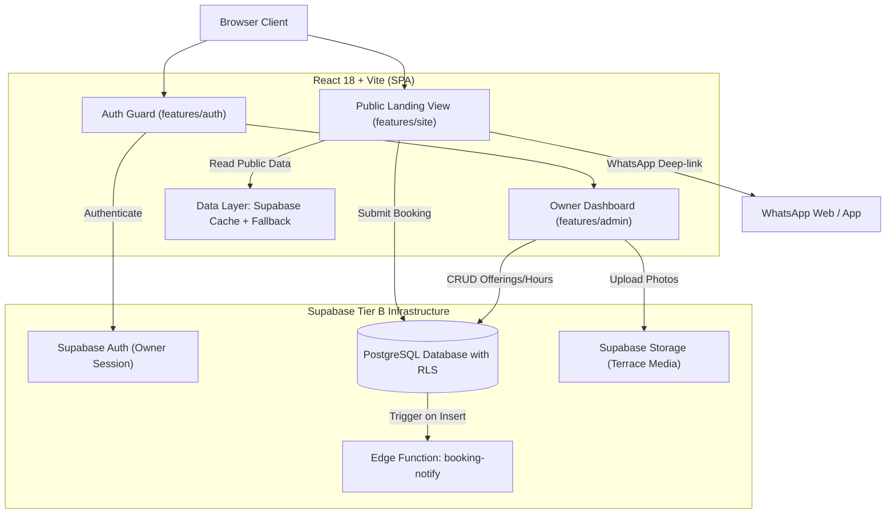

# Architecture & System Design: La Terrasse Plus (ARCHITECTURE.md)

## 1. Architectural Overview & Tier B Scope
La Terrasse Plus is structured as a Tier B production application (Public Landing Page + Lightweight Owner Portal). It couples high-performance static delivery with dynamic Supabase capabilities for owner-driven real-time updates.

## 2. Routing Strategy
The application uses lightweight client routing with route guards:

| Path | Access Level | Description |
| :--- | :--- | :--- |
| `/` | Public | Full single-page experience (Hero, Menu, Swing, Reviews, Map, Booking) |
| `/login` | Public | Owner login screen with email/password authentication |
| `/admin` | Protected (Owner) | Master management dashboard (Overview, Stats, Quick Toggles) |
| `/admin/offerings` | Protected (Owner) | Menu manager: price updates, availability toggles, badge tags |
| `/admin/hours` | Protected (Owner) | Operating schedule manager (standard hours vs Ramadan timing) |
| `/admin/reservations` | Protected (Owner) | Table booking triage list with status flags (New, Confirmed) |
| `/admin/tasks` | Protected (Owner) | Action checklist seeded from `missing[]` contract gaps |

## 3. State Management & Data Resilience
1. **Server State & Stale-While-Revalidate**:
   - Queries fetch active database records (`businesses`, `offerings`, `business_hours`, `gallery_items`).
   - SWR pattern: Immediate display of cached/seed data, silent background revalidation, optimistic local updates.
2. **Zero-Failure Seed Fallback**:
   - If Supabase environment variables are missing or connection fails, the frontend automatically falls back to `#site-data` / `seed.sql` values.
   - Ensures the customer-facing landing page never renders empty or throws unhandled promise errors.
3. **Client State**:
   - Minimalist React state for UI interactions: menu category filter, swing physics tilt, festoon lighting toggle, reservation modal, and mobile drawer.

## 4. Security & Data Protection
- **Row Level Security (RLS)**: Public role (`anon`) has read-only access to published tables. Public write is strictly limited to the `reservations` table.
- **Admin Isolation**: All update/delete/insert operations on business data require verified JWT matching `auth.uid() = owner_id`.
- **Algerian Law n° 25-11 Compliance**: Customer contact information collected through the reservation form is stored strictly for booking confirmation and never sold or shared.
