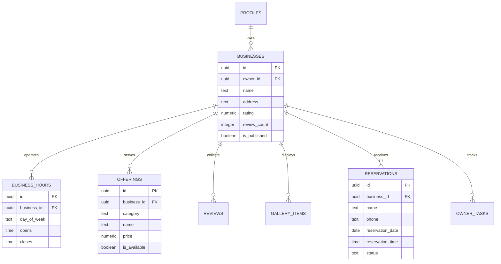

# Database Architecture & Specification (DATABASE.md)

## 1. Entity-Relationship Model
The schema implements Tier B data storage for La Terrasse Plus, grounded in `maps-to-landing/site-data@1`:



## 2. Table Catalog
1. `profiles`: Extends Supabase `auth.users` with display metadata and authorization roles (`owner`, `admin`).
2. `businesses`: Core identity, coordinates, rating, contact phone, and WhatsApp numbers.
3. `business_hours`: Structured schedule mapping weekly opening and closing hours.
4. `offerings`: Menu items with numeric prices (in DZD), categories, and dietary tags.
5. `reviews`: Real customer reviews sourced from Google Maps and Facebook.
6. `gallery_items`: Photo slots mapped to visual layout tokens.
7. `reservations`: Inbound table booking inquiries with status workflow.
8. `owner_tasks`: Checklist items populated directly from contract `missing[]` entries.

## 3. Row-Level Security (RLS) Policy Matrix

| Table | Anon / Public Read | Anon / Public Write | Owner / Authenticated |
| :--- | :--- | :--- | :--- |
| `businesses` | `SELECT` (published) | None | Full CRUD |
| `business_hours` | `SELECT` | None | Full CRUD |
| `offerings` | `SELECT` | None | Full CRUD |
| `reviews` | `SELECT` | None | Full CRUD |
| `gallery_items` | `SELECT` | None | Full CRUD |
| `reservations` | None | `INSERT` (validated) | Full CRUD |
| `owner_tasks` | None | None | Full CRUD |
| `profiles` | None | None | Read/Update Self |

## 4. Application & Migration Runbook
1. Open your Supabase project SQL Editor.
2. Run `/supabase/migrations/0001_master_schema.sql` to instantiate tables, indexes, triggers, and RLS policies.
3. Run `/supabase/seed/seed.sql` to populate verified business details, offerings, and owner tasks.
4. Create an authentication user in Supabase Auth with the owner's email (`wahid@laterrasseplus.dz`).
5. Link the owner profile:
   ```sql
   UPDATE businesses
   SET owner_id = (SELECT id FROM auth.users WHERE email = 'wahid@laterrasseplus.dz')
   WHERE id = 'b0000000-0000-0000-0000-000000000001';
   ```
